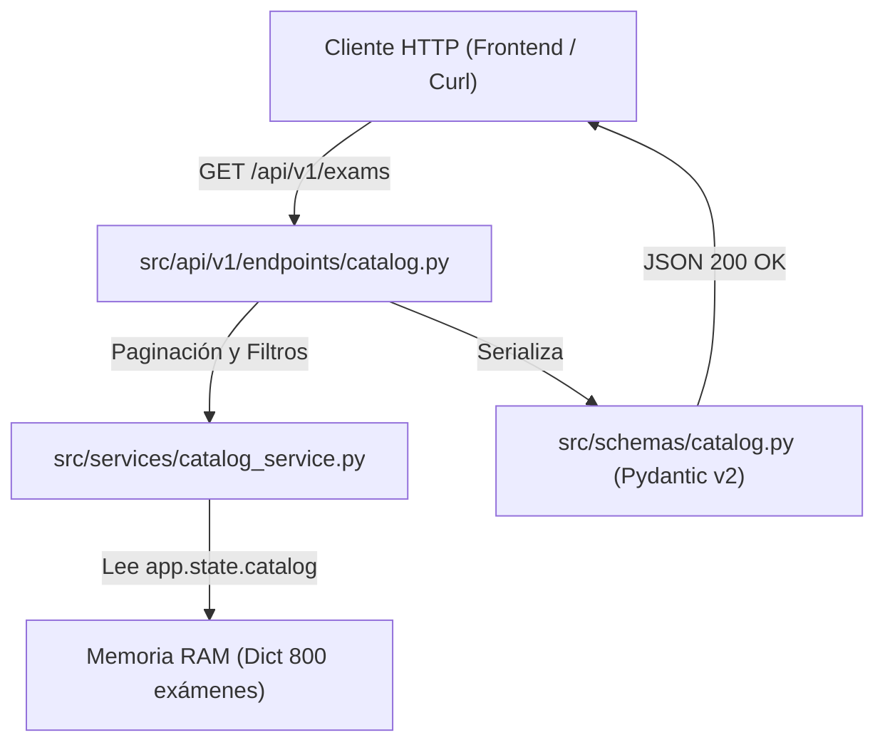

# Documentación de Implementación — Etapa 1: Infraestructura y Catálogo

## 1. Resumen de lo Implementado

En esta primera etapa se completó la base operativa del backend y el módulo completo de catálogo de exámenes universitarios de Nottingham:

1. **Infraestructura Base de FastAPI:**
   - Aplicación FastAPI estructurada en `src/api/main.py`.
   - Soporte y configuración de CORS en `src/core/config.py`.
   - Prefijo unificado `/api/v1` para todas las rutas de negocio.
   - Documentación OpenAPI viva en `/api/v1/docs` (Swagger UI) y `/api/v1/redoc` (ReDoc).
2. **Ciclo de Vida (*Lifespan Handler*):**
   - Precarga determinista en memoria de los 800 exámenes desde `data/interim/exams_clean.csv` durante el startup mediante `load_exams_catalog`.
   - Disponibilidad del catálogo indexado en `app.state.catalog` para resolver peticiones en < 5 ms sin I/O de disco.
3. **Módulo de Catálogo de Exámenes:**
   - Esquemas Pydantic v2 en `src/schemas/catalog.py`: `ExamOut`, `ExamListResponse` y `DepartmentOut`.
   - Servicio de lógica de negocio en `src/services/catalog_service.py` con filtrado por departamento, búsqueda textual por ID/nombre y paginación determinista.
   - Endpoints REST en `src/api/v1/endpoints/catalog.py`:
     - `GET /api/v1/exams`: Listado paginado con filtros (`department_code`, `search`, `limit`, `offset`).
     - `GET /api/v1/exams/{exam_id}`: Detalle de materia individual con manejo de error 404.
     - `GET /api/v1/departments`: Lista de departamentos y cantidad de exámenes por cada uno.
4. **Endpoint de Salud Actualizado:**
   - `GET /api/v1/health`: Reporta estado operativo, versión del backend y cantidad de exámenes cargados (`catalog_exams_count: 800`).
5. **Suite de Pruebas Automatizadas:**
   - `tests/test_api_health.py`: Pruebas de disponibilidad y conteo de catálogo.
   - `tests/test_api_catalog.py`: Pruebas de paginación, filtros de departamento, búsqueda textual, detalle existente, error 404 y consistencia total (suma de 800 exámenes).

---

## 2. Archivos Creados y Modificados

### Archivos Creados
- `docs/backend_implementation_plan.md`: Hoja de ruta oficial de las 4 etapas del backend.
- `docs/backend_stage_1.md`: Este documento de especificación y uso de la Etapa 1.
- `src/core/__init__.py` y `src/core/config.py`: Parámetros de entorno y rutas canónicas.
- `src/schemas/__init__.py` y `src/schemas/catalog.py`: Modelos Pydantic v2 para el catálogo.
- `src/services/__init__.py` y `src/services/catalog_service.py`: Lógica de filtrado, búsqueda y agrupación.
- `src/api/__init__.py`, `src/api/v1/__init__.py`, `src/api/v1/endpoints/__init__.py`: Paquetes API.
- `src/api/v1/endpoints/health.py`: Endpoint de healthcheck.
- `src/api/v1/endpoints/catalog.py`: Endpoints de exámenes y departamentos.
- `src/api/v1/router.py`: Agregador de routers v1.
- `src/api/main.py`: Punto de entrada FastAPI, lifespan y middlewares.
- `tests/test_api_health.py`: Tests de salud y conteo de catálogo.
- `tests/test_api_catalog.py`: Tests unitarios y de integración para el catálogo.

### Archivos Modificados
- `requirements.txt`: Agregadas librerías `fastapi>=0.110.0`, `uvicorn[standard]>=0.28.0`, `pydantic>=2.6.0`, `httpx>=0.27.0`.

---

## 3. Arquitectura y Flujo de Datos



1. Durante el arranque (`lifespan`), `load_exams_catalog(settings.EXAMS_CLEAN_PATH)` lee `data/interim/exams_clean.csv` y almacena el diccionario en `app.state.catalog`.
2. Las solicitudes HTTP no acceden al sistema de archivos ni ejecutan operaciones de I/O bloqueante.
3. Los parámetros `limit` y `offset` están acotados por validadores de FastAPI (`limit` entre 1 y 1000, `offset` $\ge 0$).

---

## 4. Instalación y Ejecución

### 4.1. Instalación de Dependencias
Dentro del entorno virtual:
```bash
source venv/bin/activate  # En Linux/WSL
# .\venv\Scripts\Activate.ps1 en Windows
pip install -r requirements.txt
```

### 4.2. Iniciar el Servidor de Desarrollo
```bash
uvicorn src.api.main:app --reload --port 8000
```
La API quedará disponible en `http://localhost:8000`.

### 4.3. Ejecutar los Tests
```bash
python -m unittest discover -s tests -v
```
*(Ejecuta los 23 tests de la suite completa: 9 de API, 6 de grafos y 8 de inferencia ML).*

---

## 5. Ejemplos de Consultas a los Endpoints

### 5.1. Healthcheck
```bash
curl -s http://localhost:8000/api/v1/health
```
**Respuesta:**
```json
{
  "status": "healthy",
  "version": "1.0.0",
  "project_name": "API de Asignación de Turnos de Exámenes",
  "catalog_exams_count": 800
}
```

### 5.2. Listar exámenes con paginación
```bash
curl -s "http://localhost:8000/api/v1/exams?limit=2&offset=0"
```
**Respuesta:**
```json
{
  "total": 800,
  "limit": 2,
  "offset": 0,
  "items": [
    {
      "exam_id": "AA2016E1",
      "exam_name": "OPERA STUDIES, I",
      "department_code": "GM",
      "duration": "1:30",
      "duration_minutes": 90
    },
    {
      "exam_id": "AA3008E1",
      "exam_name": "HOLLYWOOD & THE EUROPEAN CINEMA",
      "department_code": "AI",
      "duration": "3:00",
      "duration_minutes": 180
    }
  ]
}
```

### 5.3. Filtrar por departamento académico
```bash
curl -s "http://localhost:8000/api/v1/exams?department_code=AC&limit=2"
```

### 5.4. Búsqueda por texto (código o nombre)
```bash
curl -s "http://localhost:8000/api/v1/exams?search=OPERA"
```

### 5.5. Consultar una materia específica por ID
```bash
curl -s http://localhost:8000/api/v1/exams/AA2016E1
```
**Respuesta (200 OK):**
```json
{
  "exam_id": "AA2016E1",
  "exam_name": "OPERA STUDIES, I",
  "department_code": "GM",
  "duration": "1:30",
  "duration_minutes": 90
}
```

### 5.6. Consultar un examen inexistente (Error 404)
```bash
curl -s http://localhost:8000/api/v1/exams/ID_INEXISTENTE
```
**Respuesta (404 Not Found):**
```json
{
  "detail": "Examen con id 'ID_INEXISTENTE' no encontrado en el catálogo."
}
```

### 5.7. Listar departamentos académicos
```bash
curl -s http://localhost:8000/api/v1/departments
```
**Respuesta (200 OK):**
```json
[
  { "department_code": "AC", "exams_count": 8 },
  { "department_code": "AI", "exams_count": 12 },
  ...
]
```

---

## 6. Limitaciones Conocidas y Pendientes para la Etapa 2

- **Alcance actual:** Esta etapa provee exclusivamente la navegación y búsqueda sobre el catálogo universitario de 800 materias.
- **Pendiente para la Etapa 2 (Integración del Grafo):**
  - Carga de la matriz de probabilidades de los 319.600 pares (`pair_probabilities_oof.csv`) en el lifespan.
  - Implementación del servicio de grafo conectando `build_conflict_graph_from_predictions`.
  - Endpoint `POST /api/v1/graph` para obtener la topología del grafo según el umbral ($\theta$).
  - Endpoint `GET /api/v1/conflicts/pair` para consultar la probabilidad de conflicto entre dos materias del catálogo.
